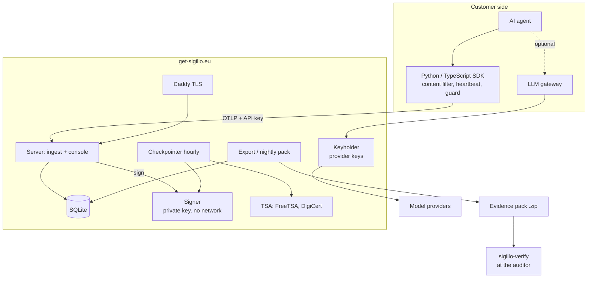

# Sigillo — Map of the vault

Start here. Italian summary: [[Panoramica]]. Rules for AIs: [[README]] and [[Working rules]].
The **code wins** over every note. Notes marked *[docs]* or *documenti* come from documents, not code.

## The whole system

## Concepts
[[Receipt]] · [[Hash chain]] · [[Signatures and keys]] · [[Merkle tree]] · [[Checkpoint]] · [[Timestamp]] · [[Anchoring]] · [[Salted digests and openings]] · [[Pseudonyms and subjects]] · [[Artifacts and text fingerprints]] · [[Evidence pack]]

## Components
- Libraries and tools: [[Core library]] · [[Verifier]] · [[Python SDK]] · [[TypeScript SDK]]
- Processes: [[Server]] · [[Signer]] · [[Keyholder]]
- Inside the server: [[Database]] · [[Ingest - OTLP traces]] · [[Native receipts API]] · [[Heartbeat and guard]] · [[LLM gateway]] · [[Tool reconciler]] · [[Chain health]] · [[Checkpointer]] · [[Daily exporter]] · [[Accounts and authentication]] · [[Web console and site]] · [[Server CLI]]

## Flows
[[Flow - agent action to receipt]] · [[Flow - hourly seal]] · [[Flow - export and verification]] · [[Flow - gateway call]] · [[Flow - erasure]]

## Operations, security, privacy
[[Deployment]] · [[Backups and updates]] · [[Configuration]] · [[Limits and throttling]] · [[CI and release]] · [[Security model]] · [[Data protection]]

## Business (Italian)
[[Business model and prices]] · [[Legal and compliance]] · [[Partners and market]] · [[Working rules]] · [[Status and open items]]

## Reports and history
[[Code defects]] · [[registro-lavori]]

Visual map: Obsidian graph view (Sigillo.canvas was removed on 2026-11-10 at the owner's request).
