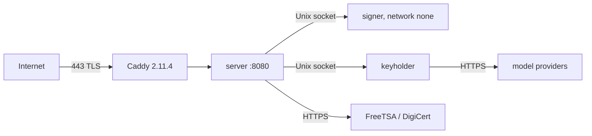

# Deployment

Production: `get-sigillo.eu`, a server at **Aruba (Italy)** [docs], Docker Compose with **four containers**:

- `Dockerfile` has 3 targets (server, signer, keyholder) from a pinned `node:22-bookworm-slim`; the server image includes `openssl`, the [[Verifier]] bundle and `backup.sh`.
- [[Signer]]: no network, key in its own volume. [[Keyholder]]: own box key. Server: no published port, admin password as a Docker secret file, feature switches set to `all`, `TSA_URL` freetsa, `TSA_URL_2` digicert.
- Caddy: TLS, strict CSP with a script hash, 16 MB body limit, log filter (no query strings).
- Local trial: `deploy/docker-compose.local.yml` (server + signer on 127.0.0.1, example agents).

Related: [[Backups and updates]], [[Configuration]].
